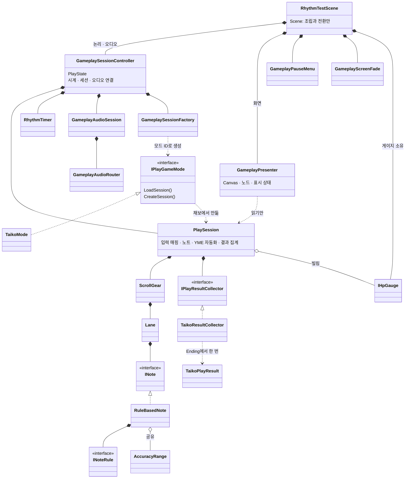
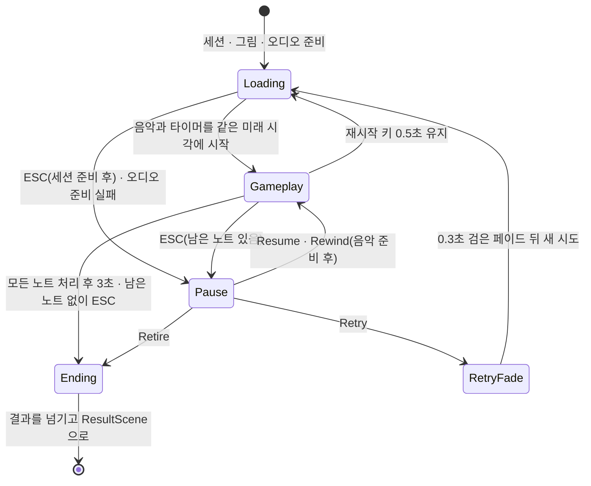

# 플레이 구조

플레이 화면(`RhythmTestScene`)을 이루는 클래스와 플레이 상태가 바뀌는 길을 그림으로 보여 줍니다.
한 프레임 안의 호출 순서는 [실행 흐름](ExecutionFlow.md#플레이-한-프레임), 동작 계약은
[Rules](../Features/Gameplay/Rules.md)·[Pause](../Features/Gameplay/Pause.md)·[Presentation](../Features/Gameplay/Presentation.md)에 있습니다.
근거 파일이 바뀌면 그림도 같이 고칩니다([변경 영향 지도](../Contributing/ChangeImpactMap.md#구조-그림)).

## 클래스

근거: `Client/GameScene/RhythmTestScene/RhythmTestScene.h`, `Client/GameFlow/GameplaySessionController.h`,
`Client/GameFlow/Submodules/GameplayAudioSession.h`·`GameplaySessionFactory.h`, `Client/GameScene/RhythmTestScene/Submodules/GameplayPresenter.h`,
`YOUMU.Modes/Mode/PlayGameMode.h`·`Submodules/PlaySession.h`·`Results/IPlayResultCollector.h`,
`YOUMU.Rhythm/Scroll/ScrollGear.h`·`Lane/Lane.h`·`Note/Submodules/RuleBasedNote.h`.

- **Scene**은 Controller·Presenter·일시정지 메뉴·화면 페이드·HP 게이지를 소유하고, 준비 순서와 Result 전환만 정합니다.
- **Controller**(`GameplaySessionController`)는 모든 모드가 같이 쓰는 실행 상태(아래)와 시계·입력·오디오 연결을 맡습니다.
  노트 규칙은 모릅니다.
- **PlaySession**은 모드가 채보로 만든 순수 상태입니다. 입력(키·QPC 시각)을 받아 노트를 판정하고
  `NoteProcessResult`(`NoteEvent`·`AudioCueRequest`·정확도)를 돌려줍니다. 화면·장치를 부르지 않습니다.
- **Presenter**는 세션을 읽기만 하고, Controller가 넘긴 피드백(`GameplayFeedback`)으로 연출을 시작합니다.
- 결과는 Ending에 들어갈 때 한 번 만들어지고(`TakeResult`) Scene을 거쳐 `ResultScene`으로 옮겨집니다.
  플레이 객체는 결과 화면까지 살아남지 않습니다.

### 노트 규칙

노트는 `RuleBasedNote` 하나에 규칙(`INoteRule`)을 끼워 만듭니다. 새 노트는 대부분 규칙만 추가합니다.

| 규칙 | Taiko 노트 |
| --- | --- |
| `TapInputRule` | 동·캇 |
| `CountedHitInputRule` | 큰 동·큰 캇 |
| `SequenceInputRule` | 보라(동·캇 한 번씩, 순서 무관) |
| `DrumRollInputRule` | 롤·큰 롤 |
| `TickRollInputRule` | 틱 롤·큰 틱 롤 |
| `HoldInputRule` | Buzz |
| `TimedSequenceInputRule` | 풍선(동 반복)·뎅뎅(동·캇 교대) |

근거: `YOUMU.Modes/Taiko/Submodules/TaikoSessionBuilder.cpp`, `TaikoLongNoteFactory.cpp`. 세부 판정은 [Rules](../Features/Gameplay/Rules.md#교체-가능한-노트-규칙).

### 화면 부품

`GameplayPresenter`가 아래 View를 소유합니다. 파일은 모두 `Client/GameScene/RhythmTestScene/Submodules/`에 있습니다(키빔만 `Client/Presentation/`).

| View | 그리는 것 |
| --- | --- |
| `GameplayNoteView` | 노트·롱노트·틱·마디선, 풍선·뎅뎅 그림과 남은 타격 배지 |
| `GameplayJudgementView` | 판정 글자, 타이밍 인디케이터와 평균 오차 |
| `GameplayKiaiView` | Kiai 판정원 |
| `GameplayInputView` | 입력 패널(누른 키) |
| `LaneKeyBeam` | 키빔 |
| `GameplayProgressView` | 진행 막대 |
| `GameplayHpView` | HP 게이지 |
| `GameplayStatisticsView` | 콤보·점수·누적 판정 |

## 상태 전이

근거: `PlayState`(`Client/GameFlow/GameplaySessionController.h`), `GameplaySessionController.cpp`, `GameplayInput.cpp`(재시작 키·ESC),
`GameplayPause.cpp`. `RetryFade`는 상태 값이 아니라 Retry를 고른 뒤 페이드가 끝날 때까지의 대기입니다(그동안 입력을 받지 않음).

- Loading 동안은 시각·판정이 흐르지 않고 플레이 화면 대신 로딩 화면을 보여 줍니다.
- Pause에서 Resume·Rewind를 고르면 메뉴는 바로 닫히지만, 음악 탐색과 시작 예약이 끝날 때까지 상태는 Pause입니다.
- 재시작과 Retry는 불러온 채보·Clip을 다시 쓰고 노트·점수·기록만 새로 시작합니다. 준비에 실패한 뒤의 Retry는 파일을 다시 읽습니다.
- 상태별 반복 작업과 복원 규칙은 [Pause의 실행 상태](../Features/Gameplay/Pause.md#모든-모드의-실행-상태)가 기준입니다.
