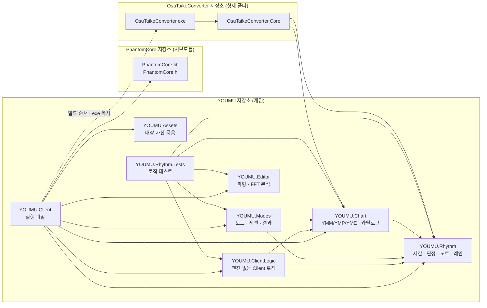
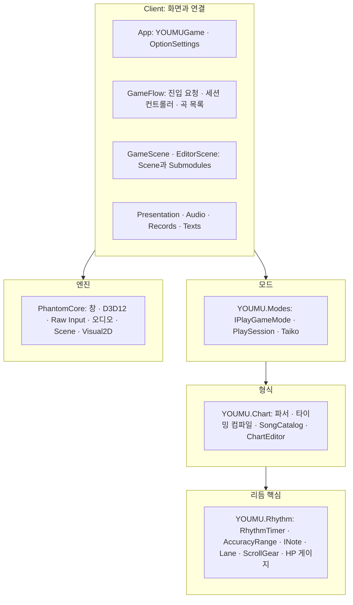
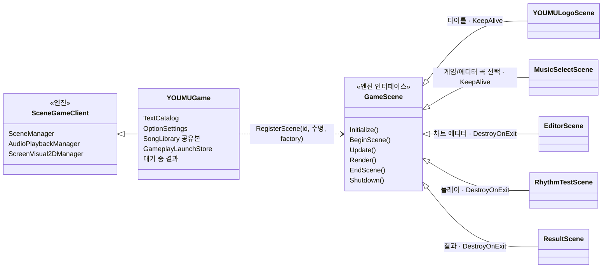

# 전체 구조

세 저장소와 빌드 프로젝트가 어떻게 이어지는지, 화면(Scene)이 어떤 클래스로 이루어지는지를 그림으로 보여 줍니다.
영역별 책임과 경계 규칙은 [설계 기준의 시스템 경계](../Design.md#시스템-경계), 시작·전환·종료 순서는
[실행 흐름](../ExecutionFlow.md), 플레이 화면 안쪽은 [플레이 구조](Gameplay.md)에 있습니다.

그림은 코드에서 옮겼습니다. 각 그림 아래의 근거 파일이 바뀌면 그림도 같이 고칩니다
([변경 영향 지도](../ChangeImpactMap.md#구조-그림)).

## 저장소와 프로젝트 의존

근거: 각 `.vcxproj`의 `ProjectReference`. 화살표는 "참조한다"입니다.

- 실행 파일은 `YOUMU.Client` 하나이고 나머지는 정적 라이브러리입니다. 엔진도 `PhantomCore.lib` 하나로 링크하며
  Client는 `PhantomCore.h`만 include합니다.
- `YOUMU.Rhythm`은 아무것도 참조하지 않는 맨 아래 층입니다. 화면·장치·파일 형식을 모릅니다.
- `YOUMU.ClientLogic`은 엔진 없이 로직 테스트로 검사할 수 있는 Client 코드입니다(기록 DB·기록 필터, 곡 필터·즐겨찾기·선택 상태,
  음악 플레이어 상태, 목록 로딩 작업, 겹친 틱 솎기). 소스는 `Client/` 아래 제자리에 두고 프로젝트만 나눴습니다.
- `YOUMU.Editor`와 `YOUMU.Assets`도 다른 프로젝트를 참조하지 않습니다. 분석은 주입받은 PCM만 다룹니다.
- Client는 변환기를 링크하지 않습니다. 빌드 순서를 맞추고 `OsuTaikoConverter.exe`를 출력 폴더에 복사한 뒤,
  `.osu` 가져오기(`EditorOsuImport`)에서 별도 프로세스로 실행합니다.
- 변환기는 YOUMU를 형제 폴더 `../YOUMU/`로 찾아 형식 계약(`YOUMU.Chart`, `YOUMU.Rhythm`)만 씁니다.
- Presentation 회귀 러너(`Tests/Presentation/Run*.ps1`)는 솔루션 프로젝트가 아니라, 실제 Client 오브젝트를 링크한
  테스트 실행 파일을 스크립트가 직접 만듭니다.

## 층과 소유

- 아래 층은 위 층을 모릅니다. 노트 규칙은 소리·화면을 직접 부르지 않고 `NoteEvent`·`AudioCueRequest`·정확도 값을
  내보내며, Client가 그것을 소리와 그림으로 바꿉니다.
- 엔진은 Client만 씁니다. 리듬·형식·모드 라이브러리는 엔진 없이 빌드되며, 그래서 도메인 CI는 FMOD 없이 돕니다.
- 경계 검사는 `Scripts/CheckArchitecture.ps1`이 프로젝트 참조·순환·엔진 include를 확인합니다.

## 화면(Scene)

근거: `Client/App/YOUMUGame.h/.cpp`(`RegisterScenes`, `CreateResultScene`), `Client/GameFlow/YOUMUSceneIds.h`, 각 Scene 헤더,
엔진 `Engine/Core/Client/SceneGameClient.h`.

| Scene ID | 클래스 | 수명 | 하는 일 |
| --- | --- | --- | --- |
| `YOUMU.Logo` | `YOUMULogoScene` | KeepAlive | 타이틀·음악 플레이어·옵션 패널 |
| `YOUMU.Lobby` | `MusicSelectScene`(Gameplay) | KeepAlive | 게임 곡 선택. 타이틀과 `SongLibrary`를 함께 씀 |
| `YOUMU.EditorSongSelect` | `MusicSelectScene`(Editor) | KeepAlive | 에디터 곡 선택·새 난이도·osu! 가져오기. 자기 `SongLibrary` |
| `YOUMU.Editor` | `EditorScene` | DestroyOnExit | 차트 에디터(`EditorWorkspace`) |
| `YOUMU.RhythmTest` | `RhythmTestScene` | DestroyOnExit | 플레이([플레이 구조](Gameplay.md)) |
| `YOUMU.Result` | `ResultScene` | DestroyOnExit | 결과·기록 저장·Retry |

- Scene 사이에는 값만 오갑니다. 곡 선택은 `GameplayLaunchStore`에 진입 요청(`GameplayLaunchRequest`)을 넣고,
  플레이·에디터 Scene은 생성될 때 그 Snapshot을 복사합니다. 플레이가 끝나면 결과(`IPlayResult`)를 `YOUMUGame`의
  대기 슬롯으로 옮기고 `ResultScene`이 그것을 가져갑니다.
- 전환은 언제나 `SceneManager::ChangeScene`(지연 전환)입니다. 활성 Scene의 `Update`가 끝난 뒤 적용되므로
  Scene이 실행 중에 자기 자신을 지우지 않습니다.
- Scene은 전환과 조립만 맡고, 일은 `Submodules/`의 Controller(논리·오디오)와 View/Presenter(Canvas·노드)가 합니다.
