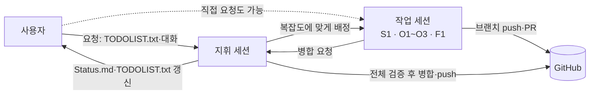
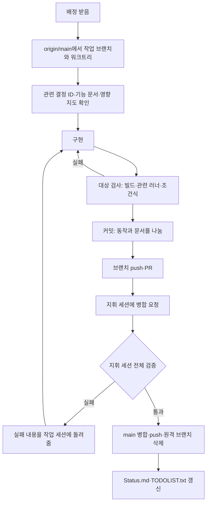

# 작업 방식

새로 참여하는 사람과 AI 세션이 같은 순서로 일하도록 정한 절차입니다. 지금 무엇이 되어 있는지는
[진행 상황](../Status.md), 검사 명령은 [빌드와 검증](Verification.md)에 있습니다.

## 처음 읽는 순서

1. 저장소 루트 [AGENTS.md](../../AGENTS.md): 지켜야 할 규칙.
2. [진행 상황](../Status.md): 구현된 것, 미구현·보류, 열린 작업.
3. [전체 구조](../Architecture/Overview.md)와 [용어집](../Glossary.md): 저장소·프로젝트·Scene 그림과 용어.
4. [설계 기준](../Design/Principles.md)과 바꿀 기능의 [설계 결정](../Design/Decisions.md) ID.
5. [기능 문서](../README.md) 중 해당 문서, [실행 흐름](../Architecture/ExecutionFlow.md)·[플레이 구조](../Architecture/Gameplay.md)(시작·화면 전환·수명·플레이를 바꿀 때).
6. [변경 영향 지도](ChangeImpactMap.md): 소유 코드와 돌려야 할 회귀 검사.

모든 문서나 엔진 SDK를 처음부터 읽지 않습니다. 선언과 직접 호출부부터 읽고 필요할 때만 넓힙니다.

## 폴더 배치

세 저장소는 같은 상위 폴더에 나란히 둡니다. YOUMU 솔루션이 변환기를 `../OsuTaikoConverter`로 참조합니다.

| 폴더 | 내용 |
| --- | --- |
| `YOUMU` | 게임(이 저장소). 엔진은 서브모듈 `Dependencies/PhantomCore`에 고정본으로 들어 있습니다 |
| `PhantomCore` | 엔진 독립 저장소. 엔진 변경은 여기서 합니다(서브모듈 체크아웃에서 고치지 않습니다) |
| `OsuTaikoConverter` | `.osu` 변환기 독립 저장소 |
| `w/<세션>/` | 작업 세션별 워크트리(아래) |

주 체크아웃(`YOUMU`, `PhantomCore`, `OsuTaikoConverter`)은 사용자와 지휘 세션의 자리입니다. 작업 세션은 읽기만 합니다.

## 역할



- **사용자**: 요청을 내고 설계를 확정합니다. 요청은 git이 무시하는 `TODOLIST.txt`(분류: 옵션·선곡화면·인게임·에디터,
  끝의 `==완료==` 아래가 완료 항목)와 대화로 들어옵니다.
- **지휘 세션**: 직접 구현하지 않습니다. 요청을 작업 세션에 배정하고, 병합 요청을 받으면 검증해 병합·push하고,
  [진행 상황](../Status.md)과 `TODOLIST.txt`를 갱신합니다.
- **작업 세션 풀**: 주제가 아니라 복잡도로 나눈 오래 유지되는 세션입니다.

  | 이름 | 모델 | 맡는 일 |
  | --- | --- | --- |
  | S1 | Sonnet | 단순·기계적인 작업 |
  | O1~O3 | Opus | 코드의 큰 흐름을 분석해야 하는 작업 |
  | F1 | Fable | 넓은 전체 설계가 필요한 작업 |

  같은 파일을 건드리는 항목은 한 세션에 모아 충돌을 피합니다.
- 사람 기여자도 같은 흐름을 따릅니다. 브랜치에서 작업하고 PR을 열며, 병합은 검증한 사람이 합니다.

## 한 작업의 흐름



### 워크트리와 브랜치

작업마다 최신 `origin/main`에서 브랜치를 만들고 자기 폴더 아래 워크트리에서 일합니다. 브랜치 이름은 `<세션>/<주제>`입니다.

```powershell
git -C YOUMU fetch origin
git -C YOUMU worktree add ..\w\o2\YOUMU -b o2/restart-fade origin/main
cd w\o2\YOUMU
git -c protocol.file.allow=always submodule update --init
# 솔루션이 ../OsuTaikoConverter를 참조하므로 변환기도 형제 위치에 둡니다(고치지 않으면 detached로 충분).
git -C ..\..\..\OsuTaikoConverter worktree add --detach ..\w\o2\OsuTaikoConverter origin/main
```

- 다른 세션의 폴더·브랜치·잠금 파일을 건드리지 않습니다.
- git stash는 모든 워크트리가 함께 씁니다. 이름 없는 `git stash`/`git stash pop`을 쓰지 말고 임시 커밋으로 비켜 둡니다.
- 작업이 끝나 병합되면 워크트리를 지웁니다(`git worktree remove`). 정션은 `cmd /c rmdir`로 링크만 지웁니다.

### 커밋과 PR

- 동작 변경과 문서 변경은 커밋을 나눕니다. 기능 계약이 바뀌면 같은 PR에서 해당 기능 문서와 결정을 함께 고칩니다.
- 문서에 날짜별 완료 기록이나 세션의 임시 상태를 적지 않습니다. 완료 기록은 Git 이력입니다.
- AI 세션의 커밋은 끝에 `Co-Authored-By:` 줄을, PR 본문은 끝에 생성 도구 표시 줄을 둡니다.
- PR 본문에는 바꾼 책임, 돌린 검사와 결과, 돌리지 못한 검사와 사람이 확인할 것(눈으로 보기·실제 입력·청음)을 적습니다.
- 엔진이나 변환기를 함께 바꾸면 그 저장소 PR이 먼저 병합되고, YOUMU PR이 엔진 gitlink를 그 커밋으로 올립니다.
- main에 직접 커밋·push하지 않고, 작업 세션은 자기 PR을 병합하지 않습니다.

### 병합 요청

PR을 열고 검사를 마치면 지휘 세션에 한 번 보냅니다. 사용자가 작업 세션에 직접 준 작업도 같습니다.

```text
병합 요청: YOUMU#82 재시작 페이드아웃 시간 조정
- 브랜치·커밋: o2/restart-fade (abc1234 동작, def5678 문서)
- 요청 요지: (사용자 요청을 한두 줄로)
- 검사: Debug/Release 빌드, RunGameplayPauseTests 통과, 조건식 0
- 못 한 검사·사람이 볼 것: 실제 화면에서 페이드 속도 확인
- 함께 병합할 PR: PhantomCore#22 먼저
```

### 지휘 세션의 병합

1. 원격을 받아 로컬 `main`에 병합합니다. 여러 요청을 묶어 한 번에 처리할 수 있습니다.
2. 무거운 검사가 없는 때에 `Scripts/Verify/VerifyAll.ps1`을 모든 러너로 한 번 돌립니다. 작업 세션의 대상 검사를 대신하는 최종 관문입니다.
3. 통과하면 push합니다. 실패하면 push하지 않고 그 PR의 작업 세션에 실패 내용을 돌려줍니다.
4. GitHub에서 PR이 MERGED로 바뀐 것을 확인한 뒤에 원격 작업 브랜치를 지웁니다.
   먼저 지우면 PR이 CLOSED로 남고 다시 열 수 없습니다.
5. [진행 상황](../Status.md)의 기준 커밋·열린 PR·항목을 고치고, 완료된 `TODOLIST.txt` 항목을 `==완료==` 아래로 옮깁니다.

## 검증과 공유 잠금

이 PC는 4코어라서 여러 세션이 동시에 빌드하거나 게임을 띄우면 서로 느려지고 시간 검사가 흔들립니다.
그래서 `Scripts/Verify`의 스크립트는 모든 워크트리가 함께 쓰는 잠금을 잡고 차례로 실행합니다.

| 스크립트 | 하는 일 | 잠금 |
| --- | --- | --- |
| `Build.ps1 [-Configuration Release] [-Analyze]` | 솔루션 빌드, `-Analyze`는 Client 코드 분석 | Engine(배타) / 분석은 Build(공유) |
| `Test.ps1 -Core -Runners A,B` | 로직·smoke(`-Core`)와 Presentation 러너 | Engine |
| `VerifyAll.ps1 [-Runners A,B]` | 두 구성 빌드·테스트·분석, 아키텍처, 조건식 검사 | 단계마다 위와 같음 |
| `SyntaxCheck.ps1 -Files a.cpp,b.cpp` | `cl /Zs` 문법만 검사(잠금 기다리는 동안) | 없음 |
| `count_conditions.py --check` 등 | 조건식 규칙, 문서 링크(`check_links.py`) | 없음 |

- 로그는 워크트리의 `build/verify/`에 남습니다.
- 잠금 파일에는 `YOUMU_SESSION_NAME` 환경 변수(예: `o2`)와 워크트리 폴더 이름이 적혀, 누가 쥐고 있는지 보입니다.
- 잠금 폴더는 `YOUMU_VERIFY_LOCKS`로 바꿀 수 있고, 없으면 주 체크아웃의 `build/verify-locks`입니다
  (예전 `build/ui02/locks`가 남아 있으면 그쪽을 씁니다).
- 대기 중에는 5분마다 앞의 대기 수와 보유자를 출력합니다. 끝난 프로세스의 잠금은 자동으로 지워집니다.

작업 세션은 바꾼 범위의 대상 검사만 돌리고, 전체 검사는 지휘 세션의 병합 때 한 번 돌립니다.
문서만 바꾸면 `python Scripts/Verify/check_links.py`와 `git diff --check`로 충분합니다.

## 지켜야 할 것

- **사용자 데이터 보존**: 사용자 Songs·음원·스킨, `Option.ini`, 실제 기록 DB를 지우거나 바꾸지 않습니다.
  검사용 데이터·캡처·로그는 git이 무시하는 `build/` 또는 테스트 데이터 경로에 둡니다. 목록 캐시는 다시 만들 수 있지만
  기록 DB는 사용자 데이터입니다.
- **확정된 설계**: 판정·정확도·점수·HP 규칙과 결정 ID가 있는 설계는 사용자 요청 없이 바꾸지 않습니다.
  버그 수정·최적화·정리도 다른 설계를 바꿀 근거가 되지 않습니다.
- **조건식**: `if`/`while` 조건 하나에 `&&`/`||`는 두 개까지입니다. 더 필요하면 조기 반환, 이름 붙인 `bool`,
  작은 술어 함수로 나눕니다(평가 순서와 부작용 유지). `count_conditions.py`·`count_expressions.py`가 0이어야 합니다.
- **보고**: 한국어로, 한 일(PR·커밋)을 먼저 적고 자동 검사와 사람이 확인할 것(화면·입력·청음)을 구분합니다.
- 큰 조사 결과나 인수인계 메모는 저장소에 넣지 않고 세션 간 공유 메모 폴더(앱이 제공하는 저장소 밖 폴더)에 둡니다.
